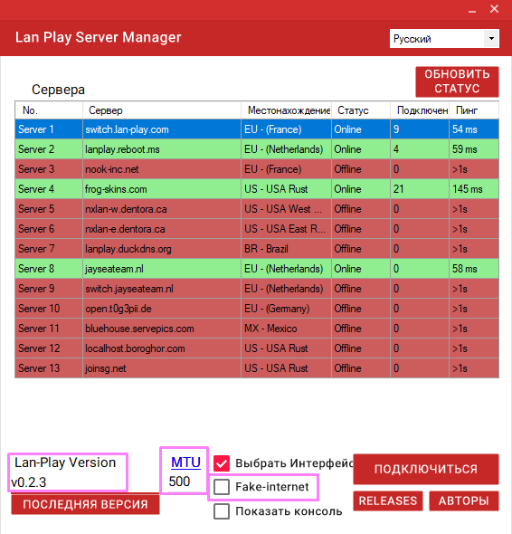

---
redirect_from:
  - /uk/lanplay.html
  - /ru/lanplay.html
  - /ru/lanplay
  - /ru/lanplay/
  - /uk/lanplay
  - /uk/lanplay/
lang: uk
permalink: /lanplay
title: Онлайн на прошитій консолі (Nextendo, LAN Play)
author_profile: true
---


На прошитій приставці за гру онлайн через сервери Nintendo бан прилітає дуже швидко. Сервери Nintendo знають, куплена ваша гра чи ні. Кожен картридж теж має унікальний ідентифікатор. Якщо з картриджа знято дамп, усі, хто вийде з цього образу онлайн, матимуть однаковий ідентифікатор. Це призведе до бану картриджа та його користувачів.

Тому в Kefir сервери Nintendo в EmuNAND заблоковані. Грати онлайн на прошитій консолі можна двома способами:

* **[Nextendo Network](#nextendo-network)** — незалежні онлайн-сервери для підтримуваних ігор. Kefir Hub вмикає їх одним перемикачем. Це найпростіший спосіб.
* **[LAN Play](#lan-play)** — локальна мережева гра через сервер-посередник. Потрібен ПК, і з іншими гравцями треба домовлятися заздалегідь.

## Nextendo Network

[Nextendo Network](https://nextendo.network){:target="_blank"} — незалежні сервери, які замінюють онлайн-сервіси Nintendo для підтримуваних ігор. Kefir Hub має вбудовані налаштування з проєкту [Prelude-Nextendo](https://git.nextendo.network/NextendoNetwork/Prelude-Nextendo){:target="_blank"}. Окремий застосунок Prelude не потрібен.

* Замість облікового запису Nintendo використовується обліковий запис Nextendo. Він безкоштовний. Підписка Nintendo Switch Online не потрібна
* Консоль не з'єднується з серверами Nintendo
* Ви граєте з іншими гравцями Nextendo: на прошитих Switch і в емуляторах Ryujinx та Citron

### Що знадобиться

* Свіжа версія  з Kefir Hub
* . Nextendo працює в EmuNAND
* Інтернет у EmuNAND: Wi-Fi або LAN підключено, режим польоту вимкнено
* Обліковий запис Nextendo. Створіть його на [сайті Nextendo](https://nextendo.network/register.html){:target="_blank"}
* Гра зі [списку підтримуваних](#підтримувані-ігри). Деяким іграм потрібна певна версія

### Увімкніть Nextendo

1. Завантажте консоль в EmuNAND і запустіть Kefir Hub
1. Відкрийте **Інструменти** → **Налаштування Кефіра** → **Nextendo**
1. Виберіть **Nextendo на emuMMC** і натисніть 
1. Утримуйте , доки смуга не заповниться
	* Kefir Hub налаштує Nextendo. Якщо він змінив файли, консоль перезавантажиться
1. Прив'яжіть консоль до свого облікового запису Nextendo. Як це зробити, описано в [посібнику Nextendo в Discord](https://discord.gg/XPfeCMwnzQ){:target="_blank"}
1. Запустіть підтримувану гру і виберіть онлайн-гру в її меню, як зазвичай

Щоб вимкнути Nextendo, вимкніть той самий перемикач **Nextendo на emuMMC**.


**Якщо Nextendo не працює**

* **Стан: Немає патча для цієї прошивки.** Цей Kefir Hub ще не має патча для вашої системної прошивки. Kefir Hub оновлюється сам, коли Prelude-Nextendo додає патч. Новий Kefir для цього не потрібен
* **Стан: Не використовується.** Консоль завантажена не в EmuNAND. Завантажтеся в EmuNAND
* Якщо ви раніше користувалися застосунком Prelude, Kefir Hub замінить його файл hosts своїм, коли ви ввімкнете Nextendo


{{ notice-nextendo | markdownify }}

### Підтримувані ігри


Список береться із сайту [Nextendo Network](https://nextendo.network){:target="_blank"} під час кожного оновлення цього посібника (останні зміни: {{ nx.updated }}). **Готово** означає, що онлайн цієї гри працює повністю. Відсоток показує, яка частина онлайну працює зараз. Найновіший стан та кількість гравців онлайн дивіться на [сайті Nextendo](https://nextendo.network){:target="_blank"}.


Зараз у списку ігор: {{ nx.games.size }}.


| Гра | Стан | Що працює (англійською) |
|---|---|---|
| {{ g.name | replace: "|", "\|" }} | Перевіряється**Готово**{{ g.pct }}% | {{ g.detail | replace: "|", "\|" }} |




### Nextendo на SysNAND (Semi-stock)

Поки ввімкнено Semi-stock, на сторінці **Nextendo** з'являється перемикач **Nextendo на sysNAND (Semi-stock)**. За замовчуванням він вимкнений.

Semi-stock призначений для офіційного онлайну Nintendo. Якщо ввімкнути цей перемикач, сервіси Nintendo спрямовуються на Nextendo, тому eShop та інші офіційні онлайн-функції можуть перестати працювати. Захисту PRODINFO в Semi-stock немає.
{: .notice--warning}

## LAN Play

Деякі ігри підтримують локальну мережеву гру. LAN Play перенаправляє дані консолі на ПК, а спеціальний сервер передає їх іншим приставкам. Усі консолі на одному сервері вважають, що вони з'єднані напряму. Цей спосіб працює навіть на забанених консолях.

Найсуттєвіший мінус: з усіма учасниками гри треба домовлятися заздалегідь. Це робиться в Discord на каналі [Switch Open - Піратський онлайн](https://discordapp.com/invite/zEMCu5n){:target="_blank"}. З гравцями з усього світу можна поспілкуватися [тут](https://discord.com/invite/JFqyGehJnc){:target="_blank"}. Домовтеся з іншими гравцями, у що будете грати і на якому сервері.

### Що знадобиться

* Свіжа версія 
* Свіжа версія [ldn_mitm](https://github.com/spacemeowx2/ldn_mitm/releases/latest){:target="_blank"} (ldn_mitm_vx.x.x.zip)
	* Рекомендується встановлювати прямо на приставці через [Kefir Hub](/hbl){:target="_blank"}: **Інструменти** → **Додаткові програми** → **Homebrew App Store**, знайдіть **ldn_mitm** ([детальніше]({{ site.kefir_hub_docs }}/uk/software/#homebrew-app-store){:target="_blank"})
* Свіжа версія програми [Lan-Play-Server-Manager](https://github.com/Urferu/Lan-Play-Server-Manager/releases/latest){:target="_blank"}
	* Користувачі MacOS та Linux можуть скористатися програмою [switch-lan-play](https://github.com/spacemeowx2/switch-lan-play){:target="_blank"}
* Драйвери [WinPCap](https://www.winpcap.org/install/bin/WinPcap_4_1_3.exe){:target="_blank"}

### Попередні налаштування

#### Частина I - Налаштовуємо клієнт

Інструкція буде дана для додатка [Lan-Play-Server-Manager](https://github.com/Urferu/Lan-Play-Server-Manager/releases/latest){:target="_blank"}, який працює тільки на Windows. Користувачі MacOS та Linux можуть скористатися програмою [lan-play-GUI](https://gbatemp.net/threads/lan-play-gui-a-graphical-interface-for-lan-play-updated-v1-0-0.525900/){:target="_blank"}. Як її налаштовувати, можна подивитися у відео, яке є за посиланням.

1. Завантажте та встановіть драйвери [WinPCap](https://www.winpcap.org/install/bin/WinPcap_4_1_3.exe){:target="_blank"}
1. Завантажте свіжу версію [Lan-Play-Server-Manager](https://github.com/Urferu/Lan-Play-Server-Manager/releases/latest){:target="_blank"} та розпакуйте її на ПК
1. Розпакуйте архів `Lan-Play-Server-Manager.zip` у зручну папку 
1. Запустіть `Lan-Play-Server-Manager.exe` від імені Адміністратора 
1. У полі **Lan-Play Version** пропишіть "**0.2.3**"
1. У полі **MTU** напишіть "**500**"
1. Зніміть галочку з пункту "**Fake Internet**" 
	
	{: .text-center}
	{: .notice--info}
1. Виберіть потрібний сервер із представлених у списку та натисніть "**Підключитися**"
	* Тільки зелені сервери будуть працювати
	* Домовтеся з іншими гравцями в [Discord](https://discordapp.com/invite/By4JA4C){:target="_blank"} на якому сервері ви будете грати
	* Якщо підключення встановлено, кнопка стане зеленою і змінить назву

#### Частина II - Налаштовуємо Switch

1. Оновіть  за інструкцією з репозиторію, якщо не робили цього раніше
1. Увімкніть приставку та перейдіть у "**Системні налаштування**" -> "**Інтернет**" -> "**Інтернет-налаштування**"
1. Виберіть ваше поточне підключення, натисніть на ньому  і виберіть "**Змінити налаштування**"
1. Виберіть пункт "**Налаштування IP-адреси**" -> "**Ручне введення**"
1. Введіть статичну IP-адресу в діапазоні від `10.13.0.1` до `10.13.255.254` (крім `10.13.37.1`)
1. Значення поля "**Маска підмережі**" встановіть у `255.255.0.0`
1. Значення поля "**Шлюз**" встановіть у `10.13.37.001`
1. Виберіть "**Налаштування DNS**" -> "**Ручне введення**"
1. У полі "**Первинний DNS**" введіть `8.8.8.8`
1. У полі "**Вторинний DNS**" введіть `8.8.8.4` і натисніть "**Зберегти**", а потім OK
	
### Підключення до LAN-play

Не в кожній грі є можливість LAN-play. Актуальний список ігор, які підтримують цей режим, можна подивитися [тут](https://docs.google.com/spreadsheets/d/1fCPkCXSy_RJCcMvde3OxCeJeFRCfnnSZPcF3A6sBOPM/edit?usp=sharing){:target="_blank"}. У деяких іграх ця функція активується [спеціальною комбінацією клавіш](http://www.lan-play.com/games){:target="_blank"}. Більш детально про це ви можете дізнатися в [Discord](https://discordapp.com/invite/By4JA4C){:target="_blank"}

Також не забувайте, що для успішного підключення всі гравці повинні мати однакову версію гри і не завжди найкращою буде остання. Уточнюйте в чаті, на якій версії слід грати і де брати апдейт.

Налаштуємо гру на прикладі Mario Kart 8

1. Запустіть гру
1. Натисніть одночасно ++(Left_Analog)
	* Ви побачите, як назва останнього пункту змінилася на "**Гра по LAN**"
1. Зайдіть у "**Гра по LAN**" і виберіть "**1г**", якщо збираєтеся грати самостійно на своїй приставці, і "**2г**", якщо на одній консолі будуть грати два гравці
1. Створіть кімнату, або підключіться до вже наявної 
1. Грайте 

### Можливі проблеми та їх вирішення

#### Помилка 2110-3127 при підключенні до WiFi

1. Lan-play запущено без прав адміністратора
1. Злетів Winpcap driver - перевстановіть його
1. Проблема на стороні роутера (трапляється з дешевими моделями) - перезавантажте роутер
1. WiFi неправильно налаштований. Переконайтеся, що в точності повторили всі пункти

#### Помилка 2160-8007

1. WiFi неправильно налаштований. Переконайтеся, що в точності повторили всі пункти

#### Помилка 2155-8007 при підключенні до серверів Nintendo

Вам і не потрібно до них підключатися

___

[Закрити сторінку](javascript:window.close();)
{: .notice--success}

